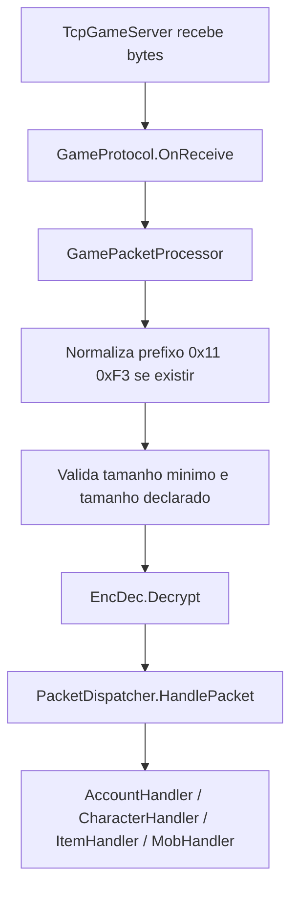
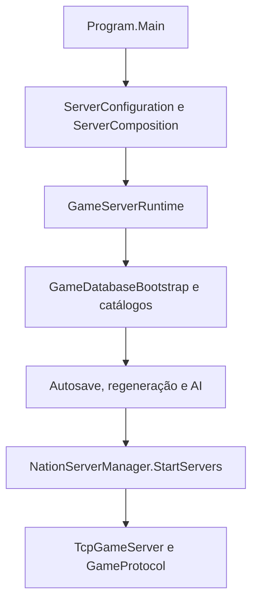

---
tags:
  - project/aika-og
  - architecture
updated: 2026-10-20
---

# Aika OG - Arquitetura Atual

## Separação de autenticação e inicialização — 2026-10-20

Refatoração local documentada em `C:\Projetcts\aika-og\docs\design\SERVER-RESPONSIBILITIES-REFACTOR.md`. `AccountAuthenticationService` contém as regras de credenciais/status; `IAccountRepository` é o contrato da aplicação e `AccountRepository` uma implementação MySQL por instância. Os handlers estáticos recebem o serviço montado em `ServerComposition.Authentication`; o restante do dispatch/gameplay mantém o padrão existente.

`Program` passa a possuir um `GameServerRuntime` por `await using`. A composição declara preparação de esquema/catálogos, início dos serviços e todas as etapas de desligamento. O runtime agrega falhas de cleanup e permite liberar serviços após início síncrono parcial. `GameDatabaseBootstrap` verifica esquema; não instala tabelas implicitamente. O accept/recycling TCP e o encerramento por sinal não foram reescritos.

No TokenServer, controllers usam `AuthenticationService` por DI, com `IAccountTokenRepository` e `MySqlAccountTokenRepository`. A fachada `AuthHandlers` e o adaptador `DatabaseHandler` continuam para compatibilidade. Ver [[Aika OG - Sistema de Auth]]. Protocolo, criptografia, SQL de autenticação e códigos de retorno preservados; sem implantação.

Verificação local: 19 testes do TokenServer e 37 de autenticação/runtime do GameServer aprovados; build da solução com zero erros. Suíte completa: 1.371 aprovados/1 falha/10 condicionais. A falha Cubo/6344 foi reproduzida sem a refatoração e o grupo passa isoladamente; consultar [[Knowledge Debt]]. MySQL isolado e cliente real não foram executados.

Atualização de persistência 2026-10-11: [[Aika OG - Banco de Dados v1 2026-10-11]]. A instalação é explícita; conexões dos servidores não criam banco/tabelas. Fonte atual: Shared/Data/DatabaseSchema.cs e Database/README.md.

Relacionado: [[Aika OG - MOC]], [[Aika OG - PacketDispatcher e Protocolo]], [[Aika OG - Sistema de Auth]]

## Visao geral

O `GameServer` esta organizado em camadas:

- `Domain`: entidades e value objects do dominio do jogo.
- `Application`: casos de uso, servicos, handlers de jogo, sessoes, mundo e configuracao.
- `Infrastructure`: rede TCP, buffers, persistencia, repositorios e carregamento de configuracao.
- `Presentation`: protocolo, streams de pacote, factories, pools e dispatch de opcodes.
- `Network`: mantem `EncDec` por compatibilidade com o cliente e o `PacketTool`.

## Camadas

### Domain

Arquivos principais:

- `GameServer/Domain/Entities/Accounts/AccountEntity.cs`
- `GameServer/Domain/Entities/Characters/CharacterEntity.cs`
- `GameServer/Domain/Entities/Items/ItemEntity.cs`
- `GameServer/Domain/Entities/Mobs/MobEntity.cs`
- `GameServer/Domain/ValueObjects/Position.cs`

Responsabilidade: representar estado e regras basicas do dominio sem depender de rede, banco ou protocolo.

### Application

Arquivos principais:

- `GameServer/Application/Services/CharacterService.cs`
- `GameServer/Application/Services/ItemService.cs`
- `GameServer/Application/Services/MobService.cs`
- `GameServer/Application/Sessions/Session.cs`
- `GameServer/Application/Sessions/SessionManager.cs`
- `GameServer/Application/Sessions/OutboundPacketQueue.cs`
- `GameServer/Application/World/WorldGrid.cs`
- `GameServer/Application/World/WorldEntitySpatialIndex.cs`
- `GameServer/Application/Handlers/Game/*Handler.cs`

Responsabilidade: coordenar fluxo de jogo, sessao ativa, criacao/listagem de personagens, escrita de pacotes de alto nivel e visibilidade no mundo.

Atualizacao 2026-07-06: visibilidade usa dois indices runtime. `WorldGrid` rastreia personagens por celula e e atualizado no movimento/logout/teleporte; `WorldEntitySpatialIndex` indexa mobs/NPCs carregados e atualiza mobs quando AI move, reseta ou respawna.

### Infrastructure

Arquivos principais:

- `GameServer/Infrastructure/Networking/TcpGameServer.cs`
- `GameServer/Infrastructure/Networking/INetwork.cs`
- `GameServer/Infrastructure/Buffers/BufferManager.cs`
- `GameServer/Infrastructure/Buffers/RingBuffer.cs` (legado; nao usado pelo envio atual de `Session`)
- `GameServer/Infrastructure/Persistence/GameDatabase.cs`
- `GameServer/Infrastructure/Persistence/Repositories/*Repository.cs`

Responsabilidade: detalhes externos, como socket TCP, pool de buffers, conexao MySQL e consultas SQL.

Atualizacao 2026-07-06: `TcpGameServer` centraliza o aluguel/devolucao de `SocketAsyncEventArgs` e coordena `BufferManager` para os buffers de leitura. `SessionManager` nao possui mais pool privado de socket args nem pool de `Session`.

### Presentation

Arquivos principais:

- `GameServer/Presentation/Protocol/GameProtocol.cs`
- `GameServer/Presentation/Protocol/Packets/GamePacketProcessor.cs`
- `GameServer/Presentation/Packets/PacketDispatcher.cs`
- `GameServer/Presentation/Packets/PacketStream.cs`
- `GameServer/Presentation/Packets/PacketFactory.cs`

Responsabilidade: transformar bytes em pacotes, descriptografar, interpretar cabecalho, rotear opcode e montar respostas.

## Fluxo de pacote recebido

## Fluxo de inicializacao

## Pontos de atencao

- `EncDec` e keys sao contrato binario com o cliente.
- `PacketStream` preserva escrita/leitura little-endian usada pelos pacotes.
- `PacketPool.Return` reseta streams e limita retencao; factories devem chamar `GetBytes()` antes de devolver o stream ao pool.
- `PacketFactory.FinalizePacket` escreve tamanho nos dois primeiros bytes.
- `Session.SendPacket` usa fila outbound por pacote e apenas um `SendAsync` ativo por sessao; `RingBuffer` nao participa mais do envio de sessao.
- [[Aika OG - Rede Heartbeat e Desconexao 2026-11-03]]: acumulador linear implementa framing, leitura/consumer e envio são aguardados/limitados por sessão, heartbeat opt-in mede RTT e patch do cliente retorna ao login com aviso. Homologação de gameplay/ativação separada dos testes. [[Aika OG - Buffers Pools e Framing TCP 2026-11-02]] conserva a investigação histórica; RingBuffer/ObjectPool não foram ativados.
- `SessionManager` mantem indice O(1) de character id para sessao; broadcasts devem usar `VisibilityBroadcastService`.
- AI/visibilidade/broadcast nao devem voltar a fazer scans globais de sessoes/mobs/NPCs nos loops quentes.
- Repositórios mantêm SQL em `Infrastructure`. Autenticação já depende de interfaces em `Application`; os demais serviços de gameplay ainda usam o padrão estático atual.
