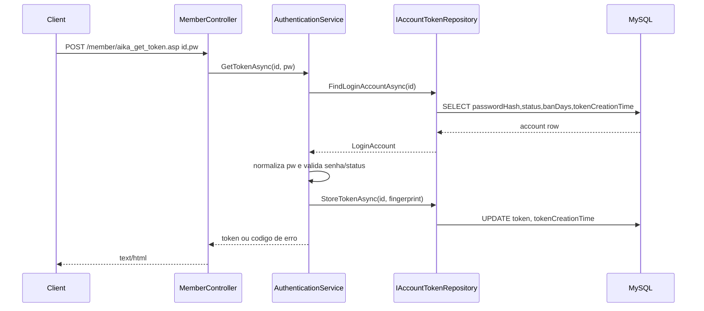

---
tags:
  - project/aika-og
  - auth
  - token-server
updated: 2026-11-02
---

# Aika OG - Sistema de Auth

> [!important] Porta legada e regressão corrigida — 2026-11-02
> TokenServer deve continuar escutando HTTP8090, inclusive quando a execução pelo Visual Studio injeta URLs5000/5001/4430. A flexibilização de `UseUrls` introduzida na correção Sonar desviava o listener; foi reproduzida com requisição real (8090 indisponível/5000 respondendo) e revertida para `UseUrls("http://*:8090/")`. Três casos RED/GREEN, suíte TokenServer25aprovados/1ignorado e14testes focados GameServer, incluindo bytes recebidos por socket real, passaram. Usuário confirmou login funcionando após recompilar/iniciar pelo VS. Não houve mudança de protocolo/credenciais. Evidência: `docs/operations/LOGIN-PORT-REGRESSION-2026-11-02.md` no repositório. O Sonar anterior não foi repetido porque a instância local estava desligada; ver [[Aika OG - Sonar Servidores 2026-11-02]].

> [!important] Separação de responsabilidades — 2026-10-20
> Controllers do TokenServer recebem `AuthenticationService` por DI. O serviço valida credenciais/status e coordena `IAccountTokenRepository`; apenas `MySqlAccountTokenRepository` executa SQL. `TimeProvider` torna os limites do banimento testáveis. `AuthHandlers` mantém as assinaturas antigas delegando ao serviço. No GameServer, validação do ticket/status saiu do repositório para `AccountAuthenticationService`, dependente de `IAccountRepository`; os dois handlers foram atualizados. Rotas, códigos, formato CNT, PBKDF2, SHA-256, comparação constante e pacotes preservados. Refatoração local sem implantação; detalhes e evidências em `docs/design/SERVER-RESPONSIBILITIES-REFACTOR.md` no repositório atual.

> [!important] Patch e contrato 2026-10-17
> [[Aika OG - Patch e Contrato Login 2026-10-17]] registra o patch e o contrato atual. Na source, `0x81` e `0x685` agora validam ticket/status; a seleção exige accountId correspondente e recusa a variante curta sem ticket. O client PT usa o builder longo existente. Reply `0x82` tem 28 bytes e Nation em +25, conforme leitor nativo. A API unifica ID/senha inválidos em `-1`; detalhes de exceção ficam no log. São alterações compiladas/testadas em saída isolada, ainda sem implantação de servidor ou login real. TTL, custo uniforme de falha, ban e rate limit continuam pendentes. A frase vem de strdef4.bin.

> [!important] Atualização 2026-10-11
> Consulte [[Aika OG - Banco de Dados v1 2026-10-11]] para o contrato atual. Credenciais não usam MD5 puro no banco: o contrato legado é reforçado com PBKDF2-SHA256. Tokens são gerados com CSPRNG e persistidos como SHA-256; cadastro usa o factory compartilhado e role Player. As observações abaixo são históricas e não descrevem a baseline v1.

Relacionado: [[Aika OG - MOC]], [[Aika OG - Arquitetura Atual]]

## Componentes

- `TokenServer/Controllers/MemberController.cs`: endpoints de token e criacao de conta.
- `TokenServer/Controllers/ServersController.cs`: contagem de personagens, lista simples de servidores e reset de flag/token.
- `TokenServer/Application/Authentication/AuthenticationService.cs`: regras de autenticação e geração de tickets, sem SQL.
- `TokenServer/Application/Authentication/IAccountTokenRepository.cs`: contrato da persistência e registros de leitura.
- `TokenServer/Infrastructure/Persistence/MySqlAccountTokenRepository.cs`: consultas parametrizadas e descarte de conexões/readers.
- `TokenServer/ServerComposition.cs`: registro das dependências HTTP e composição da fachada antiga.
- `TokenServer/Handlers/AuthHandler.cs`: fachada de compatibilidade; não contém SQL.
- `TokenServer/Handlers/DatabaseHandler.cs`: adaptador antigo de conexão, mantido para compatibilidade.
- `Shared/Data/DatabaseConnectionFactory.cs`: le `AIKAOG_DATABASE` quando existir e usa connection string fallback.

## Endpoints atuais

| Metodo | Rota | Entrada | Saida |
|---|---|---|---|
| POST | `/member/aika_get_token.asp` | form `id`, `pw` | token ou codigo numerico em texto |
| POST | `/member/create_account` | JSON `username`, `passwordHash`, `accountType` | mensagem HTTP de criacao |
| POST | `/servers/aika_get_chrcnt.asp` | form `id`, `pw` | texto `CNT ... ...` |
| POST | `/servers/serv00.asp` | sem corpo | string de contagem de players por server |
| POST | `/servers/aika_reset_flag.asp` | form `id`, `pw` | sem corpo; renova token |

## Fluxo de login

## Codigos retornados por auth

- `"0"`: conta nao encontrada ou token invalido, dependendo do endpoint.
- `"-1"`: conta ausente ou senha incorreta, com resposta pública unificada.
- `"-8"`: conta banida.
- `"-10"`: conta suspensa.
- `"-22"`: ban expirado e conta liberada.
- `"-99"`: erro interno.

## Observacoes historicas (superadas pelas atualizações acima)

- `GetTokenAsync` converte o `pw` recebido para MD5 hexadecimal lowercase antes de comparar com `accounts.passwordHash`.
- `GenerateToken` usa MD5 de um GUID para gerar token hexadecimal.
- `CreateAccountAsync` ainda usa connection string local propria e tabela/campos que parecem divergentes (`password_hash`, `premiumTime`) em relacao a outros pontos (`passwordHash`, `premiumExpiration`).
- `GetCharacterCountAsync` espera `pw` como token, nao senha.
- `ResetFlag` busca conta por username/token e renova token, mas nao valida explicitamente se encontrou linha antes de atualizar.

## Recomendações históricas (consultar implementação atual)

- Unificar `CreateAccountAsync` para usar `DatabaseHandler.GetConnectionAsync`.
- Padronizar nomes de colunas entre `accounts`, entidades e queries.
- Trocar retorno textual magic-number por constantes nomeadas.
- Introduzir `AuthService` e `IAccountTokenRepository` para separar controller, regra de auth e SQL.
- Adicionar testes para codigos de retorno e para ban expirado.
